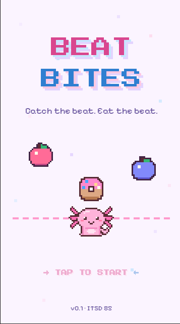
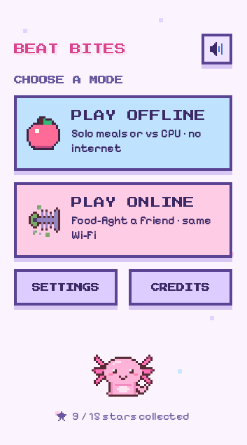
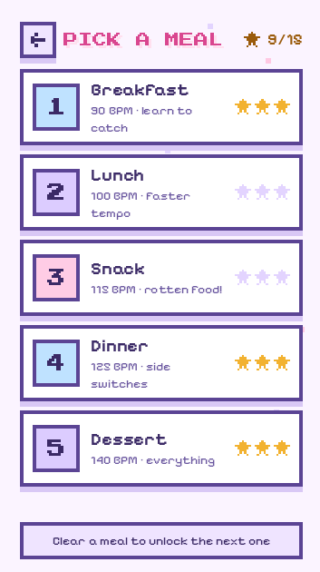
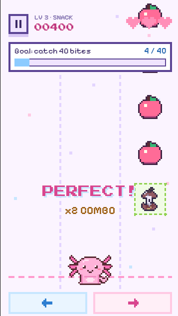
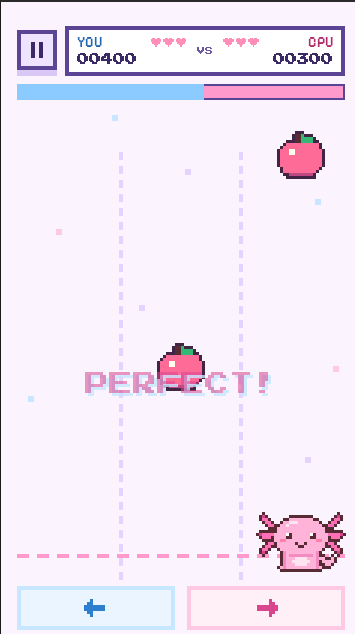
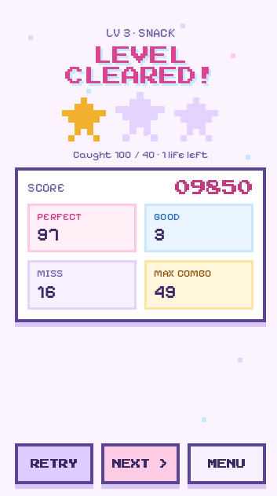
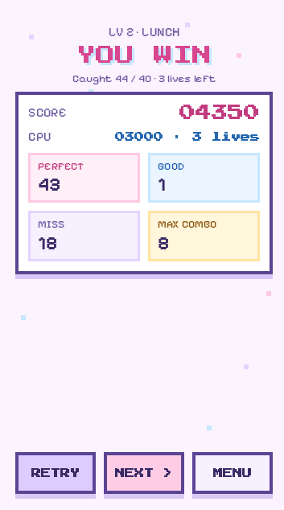
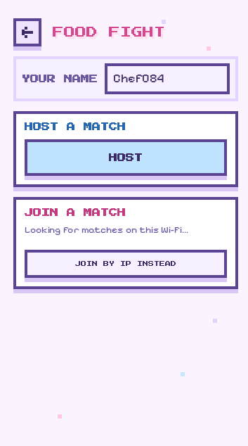
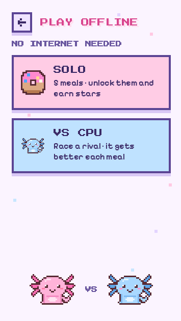
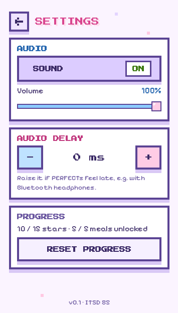

# Beat Bites

A rhythm catching game for Android, made with Godot 4 for ITSD 85 (Mobile Game with Level Progression and Offline/Online Multiplayer).

Food falls in three lanes on the beat of the music. Move the axolotl catcher between lanes to catch each bite on time, dodge rotten food, and clear five meals from Breakfast to Dessert. Play alone, against a CPU rival, or against a friend on a second phone.

## Screenshots

<table>
  <tr>
    <td align="center"><br><sub>Title</sub></td>
    <td align="center"><br><sub>Mode select</sub></td>
    <td align="center"><br><sub>Level select</sub></td>
    <td align="center"><br><sub>Solo gameplay</sub></td>
  </tr>
  <tr>
    <td align="center"><br><sub>VS CPU</sub></td>
    <td align="center"><br><sub>Level cleared</sub></td>
    <td align="center"><br><sub>VS CPU result</sub></td>
    <td align="center"><br><sub>Online lobby</sub></td>
  </tr>
  <tr>
    <td align="center"><br><sub>Offline modes</sub></td>
    <td align="center"><br><sub>Settings</sub></td>
    <td></td>
    <td></td>
  </tr>
</table>

## Features

- **5 levels (meals)**, each with its own song, tempo and chart: Breakfast → Lunch → Snack → Dinner → Dessert.
- **Level progression:** each meal unlocks after you clear the one before it. Progress and best stars are saved on the phone.
- **Solo:** the campaign, with 0–3 stars per level.
- **VS CPU (offline):** race a CPU rival whose accuracy goes up each level. Works in airplane mode.
- **Online (2 phones):** host/join over local Wi-Fi or a phone hotspot. The host picks the meal, both phones start in sync, and each sees the other's live score and lives. A 10-catch combo throws a rotten food at your rival. The host decides the winner.
- Title screen, credits, pause menu, sound on/off (saved), and a pixel-art UI theme.

## How to play

| Action | How |
| --- | --- |
| Move the catcher | Tap or drag in the left, middle or right third of the screen |
| Pause | Pause icon (top right) or the Android back button |

- **PERFECT** (caught ≤ 0.06 s after the beat) = 100 pts, **GOOD** (≤ 0.16 s) = 50 pts, otherwise **MISS** (breaks your combo).
- **Rotten food** (from Snack onward) costs 1 of your 3 lives if caught. Dodging it is safe.
- **Clear a level:** catch at least 40 bites and still have lives left when the song ends. Your stars equal the lives you have left.

## Playing online

1. Connect both phones to the same Wi-Fi or phone hotspot. Some school/public Wi-Fi blocks phone-to-phone connections; a phone hotspot works best.
2. Both players: **TAP TO START → PLAY ONLINE**, then type a name in **YOUR NAME** (up to 10 characters, saved on the phone).
3. Phone A: press **HOST**.
4. Phone B: phone A's match appears under **JOIN A MATCH** (e.g. "Ana's match · Snack"). Tap it to join. If it doesn't appear (some networks block broadcasts), use **JOIN BY IP INSTEAD** and type the IP shown on phone A.
5. Phone A picks a meal and presses **START MATCH**. Both players see each other's names in the match.

The game uses ENet on UDP port **24567**. Hosts announce themselves with a small UDP broadcast on port **24568**, which stays on the local network. If the connection fails, the lobby shows an error instead of crashing. If a player leaves mid-match, the other phone shows **OPPONENT LEFT**.

## Install (Android)

Install the APK from the release or submission folder _[add link]_ on an Android phone (allow "install unknown apps"). The game runs in portrait only.

## Build from source

1. Install **Godot 4.7** (standard build) and the Android export templates.
2. Clone this repo and open `project.godot` in Godot.
3. Run on desktop with **F5**. The main scene is `scenes/ui/Title.tscn`.
4. Android: **Project → Export → Android**. The preset writes `export/beatbites-debug.apk`.

## Project structure

```
autoload/      GameState.gd (mode, unlocks, stars, sound, saving)
               Net.gd (ENet hosting/joining, RPCs, clock sync, results)
scripts/       Level.gd (gameplay), Food.gd, catcher.gd, CpuRival.gd,
               PauseMenu.gd and the menu/UI scripts
scenes/levels/ level_01.tscn … level_05.tscn
scenes/ui/     Title, ModeSelect, OfflineSelect, LevelSelect, Lobby,
               result, PauseMenu, Credits
scenes/actors/ catcher.tscn, food.tscn
assets/        art, audio (songs + JSON charts), fonts, ui_theme.tres
docs/          GDD.md, CREDITS.md, playtest notes, screenshots
```

## Documentation

- [Game Design Document](docs/GDD.md)
- [Credits](docs/CREDITS.md)

## Author

_[Your name]_. Solo project for ITSD 85.
